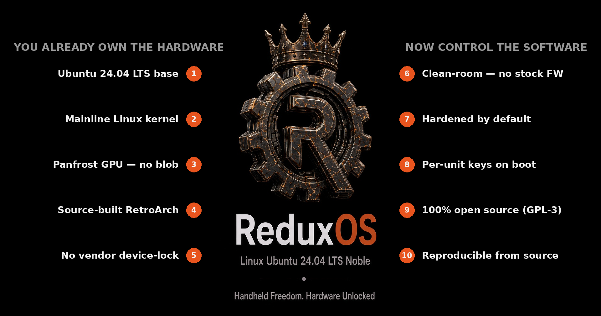

<p align="center">
  
</p>

<h1 align="center">ReduxOS — Allwinner H700</h1>

<p align="center"><em>Handheld Freedom. Hardware Unlocked.</em></p>

**A clean, ground-up Ubuntu 24.04 LTS (Noble Numbat) build for Allwinner H700 handhelds (Anbernic RG-series).**

ReduxOS is built entirely from open Ubuntu 24.04 and upstream source. It carries **nothing** from the
Anbernic stock firmware — no vendor binaries, no stock BIOS, no device-lock, no shared factory credentials.
A completely wide-open base, on hardware you own, that you can read, rebuild, and change.

> Status: **early / desk + QEMU**. Nothing here has been validated on a physical device yet. See
> [`docs/status.md`](docs/status.md) and the [`docs/roadmap.md`](docs/roadmap.md). Desk-only findings are marked as such throughout.

## What it is
- **Base:** Ubuntu 24.04 LTS (Noble), `arm64`/aarch64, built from a package manifest — no stock rootfs.
- **Kernel:** mainline-track Linux for the H700 (own config/device tree), not a vendor kernel.
- **Graphics:** KMS/GLES via **Mesa Panfrost** (Mali-G31 Bifrost). No proprietary GPU blob.
- **Frontend:** source-built RetroArch (KMS/EGL/GLES, ALSA) and open libretro cores. No bundled commercial BIOS.
- **Everything reproducible:** every byte traces to an upstream source or a script in this repo.

## What moving to 24.04 means for you
If you own one of these handhelds, here's what a ground-up **Ubuntu 24.04 (Noble)** base gives you over the
stock firmware:

- **A modern, supported base.** Ubuntu 24.04 LTS — years of security updates, current libraries and toolchain,
  not a frozen vendor build.
- **Better graphics.** Mesa 24.x **Panfrost** for the Mali-G31 (KMS/GLES) — more mature than the stock stack,
  with no proprietary GPU blob.
- **Your device is yours.** No vendor device-lock (the stock "deeplayer" anti-tamper), no reboot-on-tamper,
  nothing tying apps to a vendor kernel. You decide what runs.
- **Secure by default — and per-unit.** SSH is **off** until you add your own key (no password login, ever);
  SSH host keys and `machine-id` are generated **per unit on first boot**; the firewall is **on** with inbound
  default-deny. None of the stock firmware's shared factory credentials.
- **Open and rebuildable.** Everything builds from source and is documented (GPL-3.0) — you can read it, change
  it, and build your own image.
- **Year-2038 safe** (64-bit `time_t` on arm64), and **no telemetry** — nothing phones home.

Honest trade-offs: it's a clean build, so you **bring your own games/BIOS** (legally); a few sandboxed ports
may need an AppArmor tweak (24.04 restricts unprivileged user namespaces); and the newer stack is a little
larger on disk. Full technical detail: [`docs/ubuntu-2404-notes.md`](docs/ubuntu-2404-notes.md).

## Supported hardware (H700 family — validate per unit)
Allwinner **H700** SoC (4× Cortex-A53, Mali-G31). Target units include the Anbernic RG34XX-SP and other
H700 models (RG35XX-H/Plus/SP/2024, RG28XX, RG40XX, etc.). Panel, DRAM size, and WiFi module vary per unit —
see [`docs/hardware.md`](docs/hardware.md). **Do not drive an unidentified panel.**

## What this project deliberately does NOT contain
This is the point of a ground-up build — see the full table in
[`docs/risks-eliminated.md`](docs/risks-eliminated.md). In short, ReduxOS ships **none** of:
- Anbernic stock firmware, rootfs, or `appfs`; any vendor binary or blob.
- Any commercial / console BIOS or ROM.
- The stock device-lock ("deeplayer") or any dependency on it.
- Shared factory credentials (SSH host keys, root password, Wi-Fi PSK) — ReduxOS generates these per unit.
- Any third-party emulator source. (The in-house NDS work, "ReduxDS", is a **separate** project and is
  **not** part of ReduxOS.)

## Quick start (build)
```sh
# On an aarch64-capable build host (native arm64, or x86_64 + qemu-user-static + binfmt):
sudo ./image/build-image.sh            # builds the rootfs + image under ./out
./image/qemu/smoke-test.sh ./out/...   # boots the image in QEMU and runs checks
# Writing to an SD card is a separate, deliberate step — see docs/build.md. This repo never writes a card.
